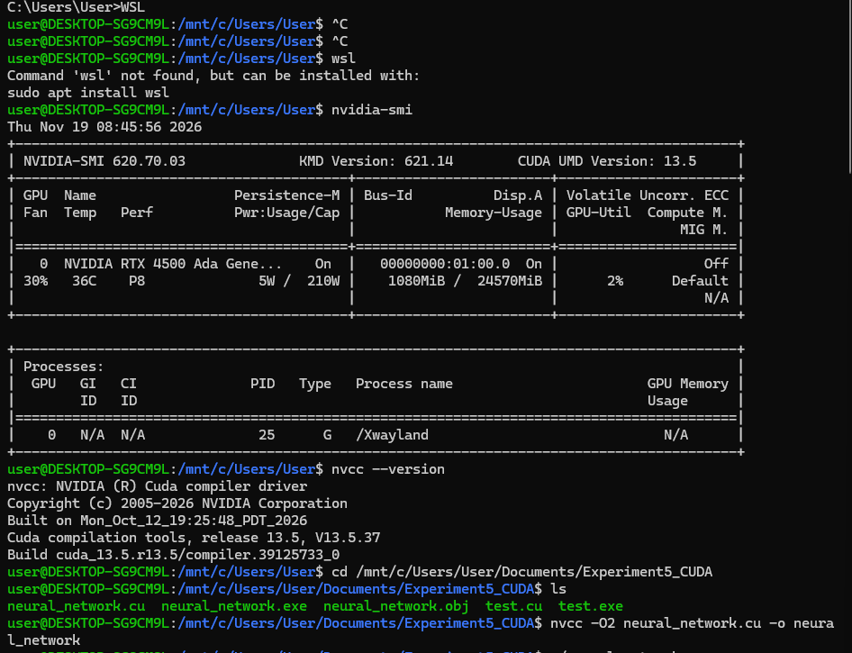
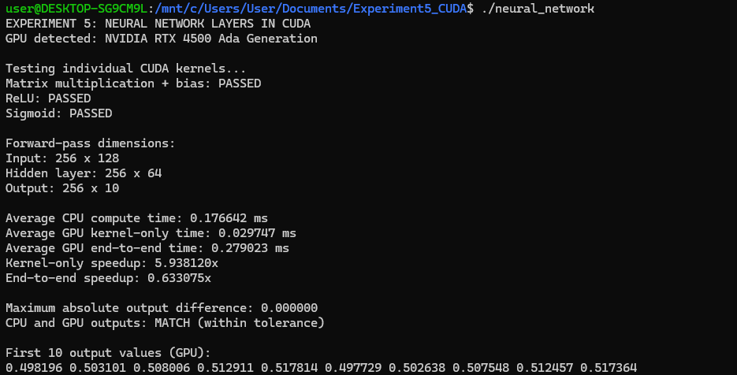
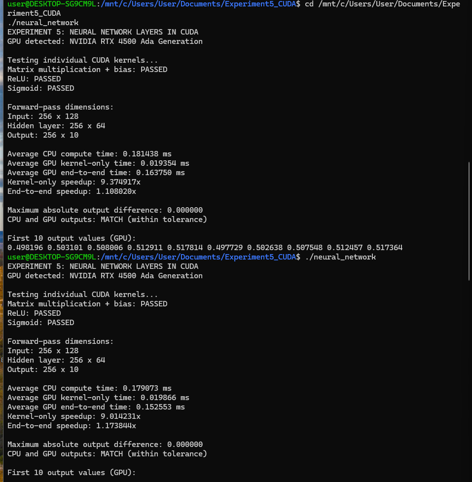
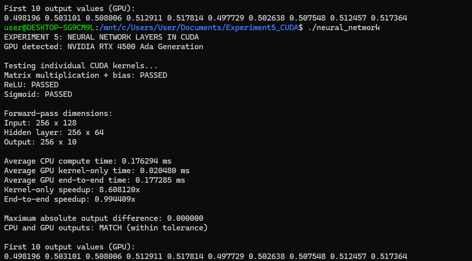
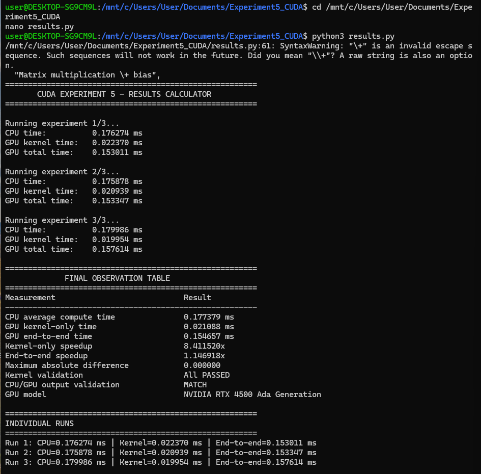
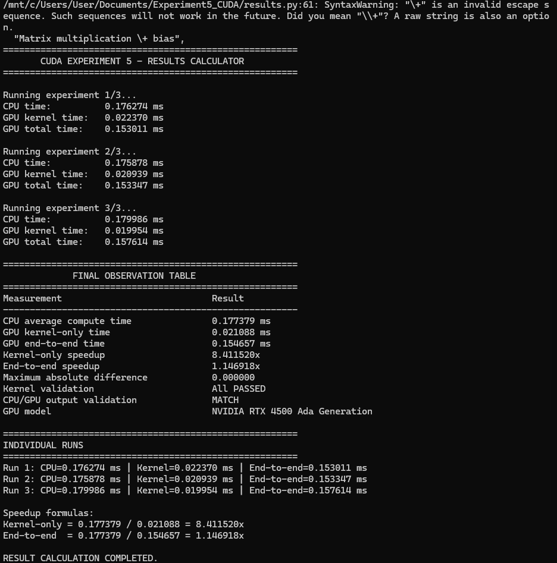
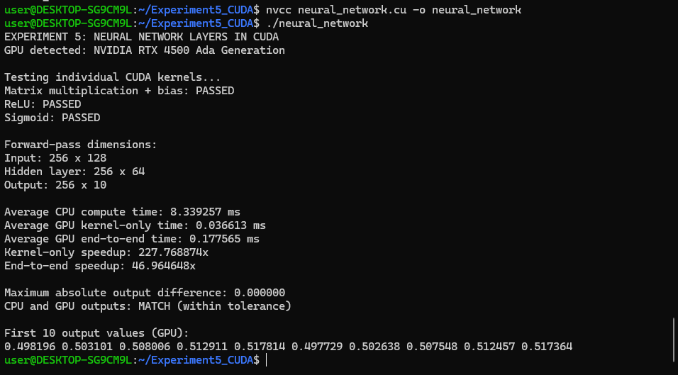

# ⚡ CUDA Experiment 5 — Neural Network Layers

<p align="center">
  <b>GPU-accelerated neural network forward pass using custom CUDA kernels</b><br>
  NVIDIA RTX 4500 Ada Generation · CUDA Toolkit 13.5 · WSL Ubuntu
</p>

---

## 📌 Experiment overview

This experiment implements and validates a small fully connected neural network forward pass using CUDA. The GPU version is compared against a CPU reference implementation.

### Operations implemented
- Matrix multiplication with bias
- ReLU activation
- Sigmoid activation
- Two-layer forward pass: matrix multiply → ReLU → matrix multiply → sigmoid
- CPU/GPU output comparison and timing measurements

### Network dimensions

| Stage | Dimensions |
|---|---:|
| Input batch | 256 × 128 |
| Hidden layer | 256 × 64 |
| Output layer | 256 × 10 |
| CPU/GPU repeats per timing | 20 |

## 🧰 Environment

| Component | Observed configuration |
|---|---|
| GPU | NVIDIA RTX 4500 Ada Generation |
| CUDA compiler | NVCC 13.5.37 |
| CUDA UMD | 13.5 |
| Execution environment | WSL Ubuntu |
| Driver shown by `nvidia-smi` | 620.70.03 |

## 📁 Repository structure

```text
PGC-Experiment-5-CUDA/
├── src/
│   └── neural_network.cu
├── scripts/
│   └── results.py
├── results/
│   ├── graphs/
│   │   ├── execution_time_across_three_runs.png
│   │   └── gpu_speedup_comparison.png
│   └── tables/
│       ├── three_run_observations.csv
│       └── observation_tables_and_chart.xlsx
├── screenshots/
│   ├── 01_cuda_gpu_and_toolkit.png
│   ├── 02_cuda_program_execution.png
│   ├── 03_multiple_execution_output.png
│   ├── 04_repeat_run_output.png
│   ├── 05_three_run_results_calculator.png
│   ├── 06_final_observation_table.png
│   └── 07_initial_cuda_build_and_run.png
└── README.md
```

## ⚙️ Build and run (WSL / Linux)

Open WSL and navigate to the repository directory:

```bash
cd PGC-Experiment-5-CUDA
```

Compile the CUDA source:

```bash
nvcc -O2 src/neural_network.cu -o neural_network
```

Run the program:

```bash
./neural_network
```

The program checks GPU availability, validates all three kernels, runs the CPU and GPU forward passes, and prints timing and output-comparison results.

### Generate a fresh three-run observation table

After compiling, run:

```bash
python3 scripts/results.py
```

The script executes the program three times, calculates average timings and speedups, and writes `results/tables/three_run_observations.csv`.

## 📊 Observed results

The following table is the three-run dataset captured in the supplied terminal screenshots and used for the graphs in this repository.

| Run | CPU compute (ms) | GPU kernel-only (ms) | GPU end-to-end (ms) |
|---:|---:|---:|---:|
| 1 | 0.176274 | 0.022370 | 0.153011 |
| 2 | 0.175878 | 0.020939 | 0.153347 |
| 3 | 0.179986 | 0.019954 | 0.157614 |
| **Average** | **0.177379** | **0.021088** | **0.154657** |

### Average speedup

| Metric | Result |
|---|---:|
| Kernel-only speedup | **8.411520×** |
| End-to-end speedup | **1.146918×** |
| Maximum absolute output difference | **0.000000** |
| Matrix multiplication + bias | **PASSED** |
| ReLU | **PASSED** |
| Sigmoid | **PASSED** |
| CPU/GPU output validation | **MATCH** |

**Formulae**

- Kernel-only speedup = CPU average compute time ÷ GPU kernel-only time
- End-to-end speedup = CPU average compute time ÷ GPU end-to-end time

> Timings are machine- and load-dependent. The table above records the three runs used for this report; new executions may produce different values.

## 📈 Observation graphs

### 1. Execution time across three runs

This line graph compares CPU compute time, GPU kernel-only time, and GPU end-to-end time for each of the three runs.


### 2. GPU speedup compared with CPU

This bar graph compares the kernel-only speedup with the end-to-end speedup.


## 🖥️ Execution screenshots

### 1. GPU and CUDA toolkit verification



### 2. CUDA program execution



### 3. Multiple execution output



### 4. Repeat run output



### 5. Three-run results calculator



### 6. Final observation table



### 7. Initial CUDA build and run



## 🔍 Result analysis

- All three individual CUDA kernel tests passed.
- CPU and GPU output values matched within the program's validation tolerance.
- The kernel-only measurement excludes data transfers because the inputs and weights are already on the GPU.
- The end-to-end measurement includes host/device transfers, kernel execution, synchronization, and output transfer.
- The end-to-end speedup is lower than the kernel-only speedup because transfer and launch overhead are included.

## ✅ Conclusion

The neural network forward pass was implemented using CUDA kernels for matrix multiplication with bias, ReLU, and sigmoid. The implementation passed all kernel tests and produced CPU/GPU outputs that matched within tolerance. Across the three recorded runs, the average kernel-only speedup was **8.41×**, while the average end-to-end speedup was **1.15×**. The experiment demonstrates the difference between measuring GPU kernel performance alone and measuring the complete GPU execution path.

---

<p align="center"><i>CUDA Experiment 5 · Neural Network Layers · GPU Computing Lab</i></p>
